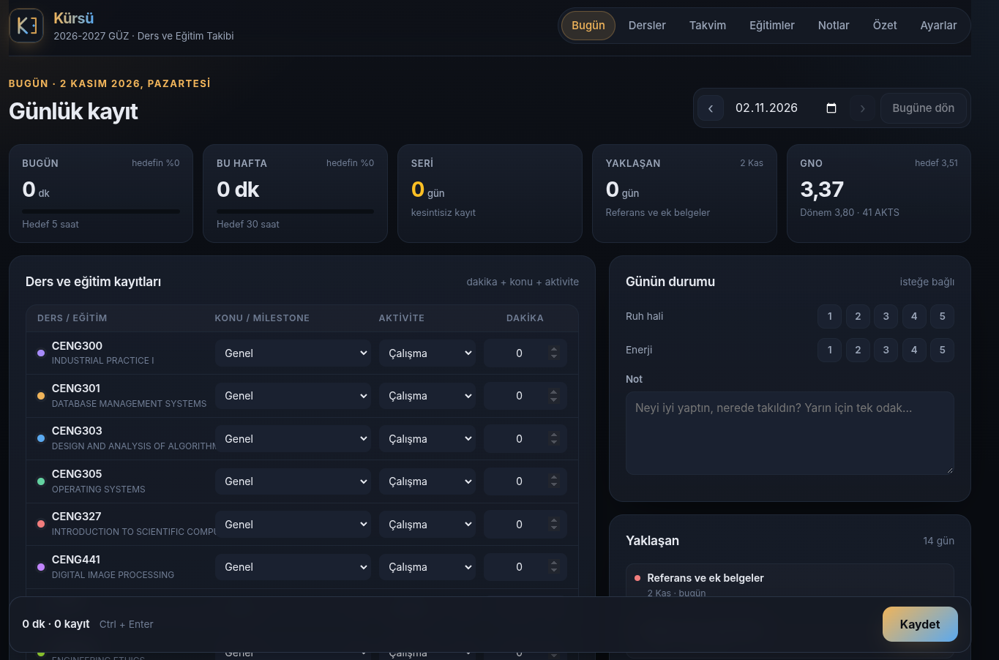
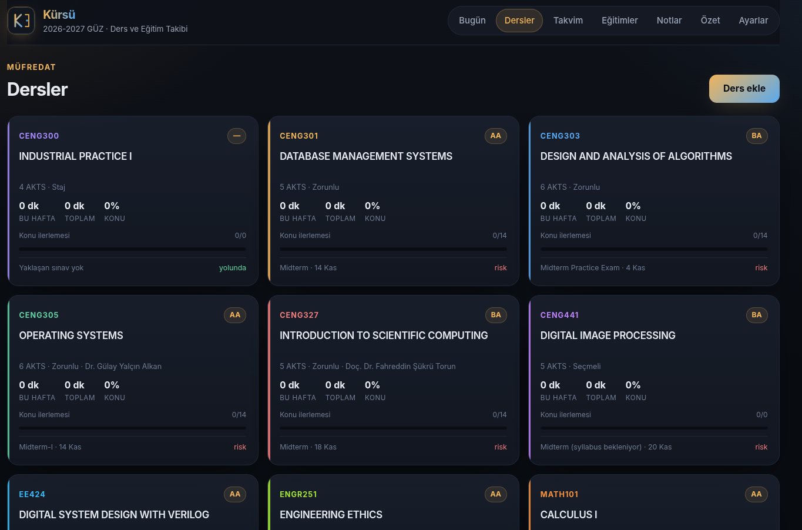

# Kürsü

<p align="center">
	
</p>

Ders, eğitim ve GNO takip paneli. Kendi derslerini ve hedeflerini ekleyerek kullanabilirsin.

## Ne yapar?

- **Bugün:** ders ve eğitim bazında dakika, konu/milestone ve aktivite kaydı; ruh hali, enerji ve gün notu.
- **Dersler:** 2026-2027 Güz dersleri, haftalık konular, değerlendirme ağırlıkları, hedef/final notu ve projeksiyon.
- **Takvim:** sınavlar ve ödev/teslimler tek listede.
- **Eğitimler:** dış eğitimleri ve milestone'ları kendin ekleyebilirsin.
- **Notlar:** AYBÜ harf notu ölçeği ve AKTS ağırlıklı dönem/kümülatif GNO.
- **Özet:** günlük/haftalık özet, 30/90 günlük grafik, ders dağılımı ve 24 haftalık ısı haritası. Rapor dosyası üretmez.
- **Ayarlar:** hedefler, GNO varsayımları, CSV dışa/içe aktarma ve AYBÜZEM (Moodle) bağlantısı.

## Gereksinim

- Node.js **24** veya üzeri (`node:sqlite` yerleşik modülü kullanılır).
- npm bağımlılığı yoktur.

## Çalıştırma

```bash
cd kursu
npm start
```

Panel: <http://127.0.0.1:5174>

Farklı port:

```bash
PORT=5175 npm start
```

Geliştirme sırasında otomatik yeniden başlatma:

```bash
npm run dev
```

Testler:

```bash
npm test
```

Testler geçici bir SQLite dosyası kullanır; `data/kursu.db` dosyasına dokunmaz.

## Veri

- SQLite veritabanı: `data/kursu.db`
- AYBÜZEM ayarları: `data/aybuzem.json` (`chmod 600`, `.gitignore` içinde)
- Veritabanı ve AYBÜZEM dosyası repoya girmez.
- Yedek: sunucu kapalıyken `data/kursu.db` dosyasını kopyala.

## 2026-2027 Güz seed verisi

Dersler: CENG300, CENG301, CENG303, CENG305, CENG327, CENG441, EE424, ENGR251, MATH101.

Toplam 45 AKTS. CENG300 staj/geçti-kaldı olduğu için GNO'ya girmez. MATH101 tekrar dersidir; final notu girildiğinde son deneme esas alınır.

GPA alanları public başlangıç verisinde boş/0 değerlerle gelir; kullanıcı bunları Ayarlar sekmesinden kendisi doldurabilir. Harf notu ölçeği AA 4.00 ile FF 0.00 arasındadır.

Syllabus verisi:

- CENG301, CENG303, CENG305, CENG327, EE424 ve MATH101 dosyalarından çıkarıldı.
- CENG441 için syllabus bulunmadığından değerlendirmeler 40/60 yer tutucu olarak işaretlendi.
- ENGR251 için yalnızca ders slaytı olduğundan değerlendirmeler 40/60 yer tutucu olarak işaretlendi.
- Sınav tarihleri ve bazı haftalık konular syllabus dışından yorumlandı; ders detayından düzeltilebilir.

## AYBÜZEM / Moodle

Faz 4 entegrasyonu `integrations/aybuzem.js` içinde hazır:

1. Ayarlar → AYBÜZEM bölümüne adres, kullanıcı adı ve şifre gir.
2. Şifre diske yazılmaz; yalnızca sunucu sürecinde token almak için kullanılır. Token `data/aybuzem.json` içinde 600 izniyle saklanır. Token yoksa veya süresi dolduysa şifreyi yeniden girmen gerekir.
3. “Şimdi senkronize et” dersleri, ödevleri ve takvim etkinliklerini salt okunur çeker.
4. AYBÜZEM'den gelen ödevler `source = 'aybuzem'` etiketiyle görevlere eklenir; manuel görevler ezilmez.
5. Moodle mobil web servisi kapalıysa bağlantı hata verir; CSV/HTML içe aktarma ve manuel giriş çalışmaya devam eder.

Moodle uçları:

- `POST /login/token.php` (`service=moodle_mobile_app`)
- `POST /webservice/rest/server.php`

Web servisi kapalıysa Ayarlar → Veri bölümünden dışa aktarılmış CSV dosyası veya Moodle tablosunu içeren HTML dosyası içe aktarılabilir. Günlük kayıtlar mevcut günle birleştirilir; değerlendirme ve görevler başlık/tarih eşleşmesiyle güncellenir. Bu akış Playwright veya tarayıcı otomasyonu kullanmaz.

## Ekran Görüntüleri

<p align="center">
	
</p>

<p align="center">
	
</p>

## API

| Metot | Yol | Açıklama |
| --- | --- | --- |
| GET | `/api/bootstrap` | Ayar, dönem, ders, eğitim, konu, milestone, değerlendirme ve görevler |
| GET | `/api/summary?date=` | Günlük özet, yaklaşanlar, riskler ve GNO |
| GET | `/api/stats?days=` | Seri, dağılım, haftalık toplamlar |
| GET/PUT | `/api/days/:date` | Günü oku / günü ve logları kaydet |
| GET | `/api/courses` · `/api/courses/:id` | Ders listesi / detay |
| POST/PUT/DELETE | `/api/courses` · `/api/courses/:id` | Ders CRUD |
| GET/POST | `/api/courses/:id/topics` | Konu listesi / ekle |
| PUT/DELETE | `/api/topics/:id` | Konu güncelle / sil |
| GET/POST | `/api/assessments` | Değerlendirme listesi / ekle |
| PUT/DELETE | `/api/assessments/:id` | Değerlendirme güncelle / sil |
| GET/POST | `/api/tasks` | Görev listesi / ekle |
| PUT/DELETE | `/api/tasks/:id` | Görev güncelle / sil |
| GET/POST | `/api/trainings` | Eğitim listesi / ekle |
| GET/PUT/DELETE | `/api/trainings/:id` | Eğitim detay / güncelle / sil |
| POST | `/api/trainings/:id/milestones` | Milestone ekle |
| PUT/DELETE | `/api/milestones/:id` | Milestone güncelle / sil |
| GET | `/api/gno` | GNO projeksiyonu |
| GET | `/api/export.csv?kind=logs\|assessments\|tasks` | CSV dışa aktarma |
| POST | `/api/import` | CSV veya HTML tablo içe aktarma (`{ kind, text }`) |
| GET | `/api/aybuzem/status` | AYBÜZEM durumu |
| POST | `/api/aybuzem/config` | AYBÜZEM ayarlarını kaydet |
| POST | `/api/aybuzem/sync` | AYBÜZEM senkronizasyonu |

## Notlar

- Arayüz tamamen Türkçe ve bağımlılıksızdır.
- Tarihler yerel saatle `YYYY-MM-DD` olarak tutulur; görev/milestone saatleri `YYYY-MM-DDTHH:MM` olabilir.
- `data/kursu.db` silinirse uygulama ilk açılışta seed verisini yeniden oluşturur.
